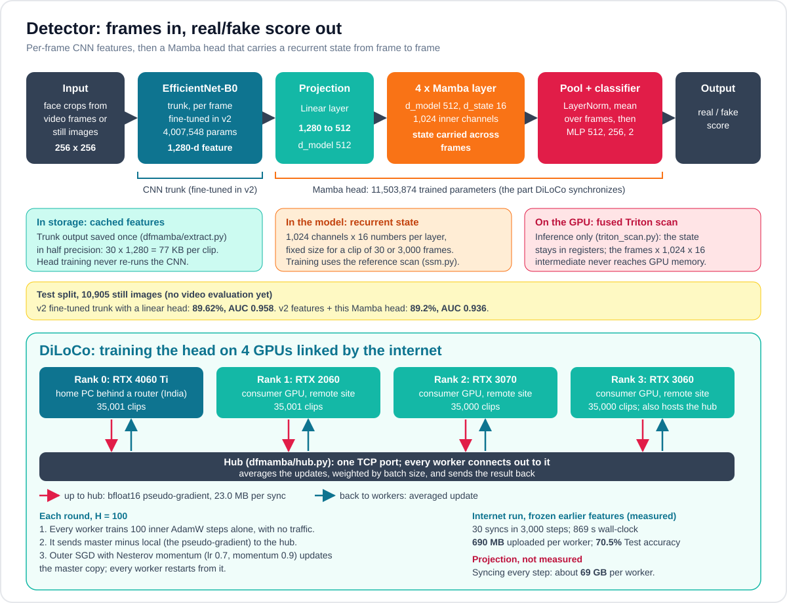

<p align="center"></p>

<h3 align="center">
A deepfake detector built from EfficientNet-B0 and Mamba, trained across GPUs over the internet with DiLoCo
</h3>

<p align="center">
| <a href="docs/DETAILS.md"><b>Results and details</b></a> | <a href="docs/architecture.svg"><b>Architecture</b></a> | <a href="#getting-started"><b>Reproduce</b></a> | <a href="https://github.com/chanakyagt/inference-kernels"><b>inference-kernels</b></a> | <a href="https://github.com/chanakyagt/detector-chip"><b>detector-chip</b></a> | <a href="https://github.com/chanakyagt/mamba-scan-accelerator"><b>mamba-scan-accelerator</b></a> |
</p>

---

## About

deepfake-detector-mamba is a detector for face deepfakes. EfficientNet-B0 reads each face frame, and a 4-layer Mamba head (a selective state space model) reads across frames while carrying a fixed-size recurrent state. The head is small enough to train on consumer GPUs with DiLoCo (Distributed Low-Communication training): each GPU trains alone for H steps, then the GPUs exchange one bfloat16 update.

The project was rebuilt from scratch in November 2026. It started as a 2025 final-year capstone, and none of the 2025 code is reused. All accuracy numbers below are on still images; video clips have not been evaluated yet.

## Highlights

- EfficientNet-B0 fine-tuned at 256 px reaches **89.62%** accuracy (AUC 0.958) on a 10,905-image Test split.
- A 4-layer Mamba head on those fine-tuned features reaches 89.2% (AUC 0.936). The head has 11,503,874 trainable parameters.
- Features are extracted once and cached in half precision, 77 KB per 30-frame clip, so head training never re-runs the CNN.
- A fused Triton scan kernel keeps the Mamba state in registers at inference and never writes the frames x 1,024 x 16 intermediate to GPU memory.
- DiLoCo with H = 100 sends 100 times less data than syncing every step: 690 MB per worker over 3,000 steps against 69,023 MB.
- A real 4-GPU run over the internet (four consumer RTX graphics cards in different places: a 4060 Ti, 2060, 3070 and 3060) uploaded 690 MB per worker and reached 70.5% Test accuracy.
- Optional int8, int4 and top-k compression with error feedback cut traffic 2x to 33x, with no accuracy cost detected at one seed.

## Architecture

<p align="center"></p>

## Results

All rows are on the Test split of a 190,335-image still-image dataset (10,905 Test images), one run each. Validation overlaps Train (13.5% byte-identical), so it is not quoted.

| What | Result | How it was measured |
|---|---|---|
| Fine-tuned EfficientNet-B0 (v2), linear head | 89.62% accuracy, AUC 0.958 | MEASURED, 256 px, full train set |
| Same, after removing Test images near Train and Validation | 88.9% to 89.5% accuracy | MEASURED, dHash distance 4 |
| v2 features + Mamba head, one worker | 89.2% accuracy, AUC 0.936 | MEASURED |
| DiLoCo H = 100, v2 features, 4 workers on one GPU | 87.5%, against 88.8% for every-step sync | MEASURED, simulated workers |
| DiLoCo H = 100, frozen earlier features | 71.5%, against 71.2% for every-step sync | MEASURED, simulated workers |
| DiLoCo over the internet, 4 GPUs | 70.5% accuracy, 690 MB uploaded per worker, 869 s | MEASURED, frozen earlier features |
| Every-step sync on the same internet run | about 69 GB per worker | projection from the measured sync cost |
| Gradient compression with error feedback | 2x to 33x less traffic | MEASURED, throttled hub on one GPU |

Full tables, caveats and the synthetic temporal check are in [docs/DETAILS.md](docs/DETAILS.md).

## Getting Started

```bash
pip install -r requirements.txt
python tests/test_all.py
```

Synthetic check (four workers on one GPU):

```bash
python scripts/make_synthetic.py --out data/synthetic
bash scripts/simulate_workers.sh data/synthetic 4 runs/sim
```

Real data. Videos are not included; see [docs/data.md](docs/data.md). Extract features once, then train on one GPU or across machines:

```bash
python -m dfmamba.extract --videos /data/videos --out data/features --frames 30
python -m dfmamba.train --config configs/default.yaml --data data/features --out runs/single --mode single
bash scripts/launch_lan.sh <rank> <world_size> <rank0_ip> data/features <batch_size>
```

Workers on different networks can connect to one hub with `--transport hub` (`python -m dfmamba.hub`). Setup for several PCs and for the hub is in [docs/multi_machine_setup.md](docs/multi_machine_setup.md). The still-image experiment is `bash scripts/run_image_experiment.sh <feature_dir> [out_dir]`.

## Repository layout

| Path | Contents |
|---|---|
| `dfmamba/` | model, Mamba scan (`ssm.py`, `triton_scan.py`), DiLoCo (`diloco.py`), hub (`hub.py`), compression, feature extraction, training |
| `configs/` | YAML configs for the image, video and synthetic runs |
| `scripts/` | synthetic data, worker launchers, image experiment, duplicate checks |
| `tests/` | scan, causality, Triton kernel and gradient-path checks |
| `results/` | logs and metrics for every table above |
| `compare/` | backbone comparison and weight-space experiments |
| `docs/` | details, data notes, multi-machine setup, related work |

## Limitations

- Evaluated on synthetic clips and still images only. Mamba's benefit across frames on real video is untested.
- On strong v2 features, DiLoCo at H = 100 scored 1.3 points below every-step sync, and 2.6 points at H = 500, in exchange for 100x and 500x less traffic.
- The internet run used frozen earlier features, so its 70.5% is not comparable to the 89.2% of the v2 head.
- Each row is a single seed. Gaps under about 1 point are not established.
- The training scan is a Python loop, fine for 30 frames; the fused kernel is inference only.
- DiLoCo assumes workers move at similar speeds. A slow worker holds back every synchronization.

## Related repositories

- [inference-kernels](https://github.com/chanakyagt/inference-kernels): GPU kernels for the detector.
- [detector-chip](https://github.com/chanakyagt/detector-chip): an 8-bit accelerator of the EfficientNet-B0 trunk in Amaranth.
- [mamba-scan-accelerator](https://github.com/chanakyagt/mamba-scan-accelerator): CNN + Mamba hardware/software co-design.

## Team

The 2025 capstone team:

- Chanakya Gattu (team lead): architecture, backbone and model selection, training, and coordination.
- A. P. Ramya: DiLoCo setup.
- P. Sai Harsha: front end and back end.
- Likhith G: data collection and cleaning.

Guided by Dr. Sai Madhavi (Rao Bahadur Y. Mahabaleswarappa Engineering College). The November 2026 rebuild is by Chanakya Gattu.

## License

MIT
