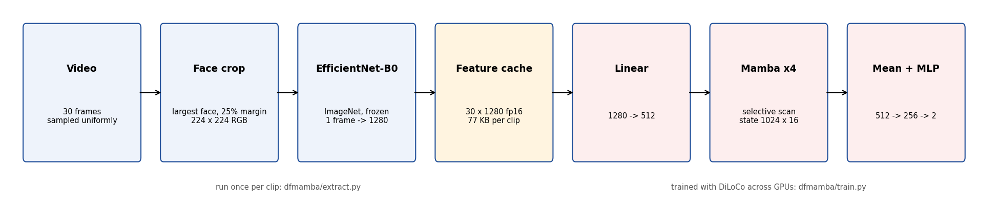

# Deepfake detector (EfficientNet-B0 + Mamba, DiLoCo): full details and results

A deepfake detector designed for video, evaluated so far on still images only, so Mamba's temporal benefit is untested on real video (it is shown only on a synthetic task built to need it). It reads each face frame with **EfficientNet-B0** and reads across frames with **Mamba** (a selective state space model). It is trained across several consumer GPUs with **DiLoCo** (Distributed Low-Communication training): each GPU trains alone for hundreds of steps, and then the GPUs exchange one small update.

Rebuilt from scratch in November 2026. It started as our final-year capstone (B.E. CSE (AI & ML), Rao Bahadur Y. Mahabaleswarappa Engineering College, 2025; paper: IJFMR Vol. 7 Issue 6, IJFMR250663645). None of the 2025 code is reused.



## Headline results

All numbers are on the 10,905-image Test split of a 190,335-image still-image dataset; none of them is on video. One run per row unless noted.

| Claim | Result | Where |
|---|---|---|
| Fine-tuned EfficientNet-B0 (v2, 256 px, full train set) | 89.62% accuracy, AUC 0.958; 88.9% to 89.5% after removing Test images within distance 4 of Train (or of Train and Validation) | `compare/results/backbones/`, `results/dataset_duplicates/near_dup.json` |
| Frozen EfficientNet-B0 + Mamba head | 73.3% accuracy, AUC 0.822 | `results/images_megadataset/` |
| Mamba head on the v2 features | 89.2% accuracy, AUC 0.936 (small heads 88.5% to 88.8%) | `results/images_megadataset_ft/`, `head_sweep_ft.md` |
| DiLoCo against every-step sync, frozen features | tie (71.5% against 71.2%), 100x less traffic | `results/images_megadataset/` |
| DiLoCo against every-step sync, v2 features | 87.5% against 88.8% at H = 100, 86.2% at H = 500 | `results/images_megadataset_ft/` |
| DiLoCo on 4 real machines over the internet | 70.5% accuracy, 690 MB per worker | `results/wan_4gpu/` |
| Gradient compression with error feedback | 2x to 33x less traffic, no accuracy cost detected | `results/diloco_compression/` |

## Design

**1. EfficientNet-B0 per frame, frozen, features cached once.** A per-frame network runs 30 times per clip, so its cost is multiplied by the clip length. EfficientNet-B0 needs 0.39 billion multiply-adds per 224 x 224 image against 4.1 billion for ResNet-50, at similar ImageNet accuracy (Tan and Le, 2019). It stays frozen, so each clip's 30 x 1,280 features are computed **once** by `dfmamba/extract.py` and stored in half precision (77 KB per clip). Training then never touches video or the CNN. That is what makes training on 4 GB laptop GPUs, and shipping the dataset to every worker, practical.

**2. Mamba across frames.** Deepfakes leave traces *between* frames (flicker, unstable blending, unnatural blinks) that one frame cannot show. A transformer compares every frame with every other, so its cost grows with the square of the clip length. Mamba (Gu and Dao, 2023) carries a fixed-size state from frame to frame: 1,024 channels x 16 numbers per layer, whether the clip has 30 frames or 3,000. Its step size and its B and C matrices depend on the current frame ("selective"), so it can decide what to keep.

- `dfmamba/ssm.py` holds the reference scan, used for training (autograd needs it).
- `dfmamba/triton_scan.py` holds a fused Triton kernel, used automatically at inference on GPU. It keeps the state in registers for the whole sequence and never writes the large (frames x 1,024 x 16) intermediate to GPU memory. This is the same idea as Mamba's hardware-aware scan.
- `tests/test_all.py` checks four things: the scan equals the unrolled sum, the output at frame t ignores later frames, the Triton kernel matches the reference, and the kernel is never used when gradients are needed.

**3. Mean over time, then an MLP.** Averaging over the 30 frames stops one noisy frame from deciding the verdict alone.

| Part (default config) | Parameters | Trained |
|---|---|---|
| EfficientNet-B0 features | 4,007,548 | no (frozen, cached) |
| Projection 1280 -> 512, 4 Mamba layers (d_state 16), norm, MLP head | 11,503,874 | yes |

## Training across GPUs with DiLoCo

`dfmamba/diloco.py` implements DiLoCo (Douillard et al., Google DeepMind, 2023) on `torch.distributed` with the gloo backend, which works over ordinary home networks:

1. Every worker starts from rank 0's weights and trains on its own shard of the clips with AdamW for **H inner steps**, with no communication.
2. Each worker computes how far it moved, `master - local` (the pseudo-gradient), in bfloat16. One all-reduce averages it across workers.
3. The average is weighted by each worker's batch size, so a laptop running a smaller batch counts proportionally. An outer SGD optimizer with Nesterov momentum (lr 0.7, momentum 0.9) applies the averaged pseudo-gradient to the master copy, and every worker restarts from it.

With the default model, each worker contributes a **23.0 MB** pseudo-gradient per synchronization (11,503,874 parameters x 2 bytes); a ring all-reduce puts about 1.5x that on the wire per worker with 4 workers. With H = 200 inner steps, that is about 200 times less traffic than synchronizing gradients after every step, which is what standard data-parallel training does. `dfmamba/train.py --mode allreduce` runs that every-step baseline with the same code, for comparison.

How to run it on several PCs over Wi-Fi or Ethernet (WSL2 mirrored networking, firewall, launch commands, troubleshooting): **[multi_machine_setup.md](multi_machine_setup.md)**.

Workers on different networks (remote GPU containers plus a home PC behind NAT) can use `--transport hub` instead: every worker connects out to one TCP port on a hub (`python -m dfmamba.hub`), which averages and returns the updates. See section 6 of the same guide. On this transport the wire estimate is 2 x payload per worker (upload plus download).

## Communication optimizations

The real internet run (`results/wan_4gpu/`) spent 400 s of its 869 s sending pseudo-gradients, 12.9 s per synchronization for 23.0 MB each way. Two options attack that. Both are off by default; the default run behaves exactly as before.

**1. Compression with error feedback** (`--compress int8 | int4 | topk`, hub transport only). Each worker shrinks its pseudo-gradient before sending. The hub decodes every worker's message to fp32, takes the batch-size-weighted average, compresses the average the same way, and sends that back, so the bytes on the wire really are smaller in both directions. Error feedback means the worker remembers what it failed to send (the true value minus the compressed value) and adds it to the next round, so nothing is lost for good, it only arrives late. The hub does the same for the average it sends back. Code: `dfmamba/compress.py`, `dfmamba/diloco.py`, `dfmamba/hub.py`.

- int8: one byte per value plus a 2-byte scale per 256 values.
- int4: two values per byte plus a 2-byte scale per 64 values.
- topk: keep the largest 10% or 1% of entries, 6 bytes each (4-byte index, 2-byte value).

**2. Overlap** (`--overlap`). At a synchronization the worker hands the exchange to a background thread and keeps training. The averaged update arrives `--overlap-delay` steps later (default: H, a whole segment) and is applied then: the master copy takes the outer step, and each worker's live parameters become `0.5 x local + 0.5 x new master` (`--overlap-alpha`). At the end of training the last update is applied and the final model is the master copy, which is identical on all workers.

**What the papers say.** The Karimireddy and Streaming DiLoCo entries were read from the arXiv abstract and the paper text; the Seide entry is from its abstract and a search summary only.

- Seide, Fu, Droppo, Li, Yu, 2014, *1-bit stochastic gradient descent and its application to data-parallel distributed training of speech DNNs*, Interspeech: gradients quantized to 1 bit per value, with the quantization error fed into the next minibatch.
- Karimireddy, Rebjock, Stich, Jaggi, 2019, *Error Feedback Fixes SignSGD and other Gradient Compression Schemes*, ICML (arXiv 1901.09847): signSGD can fail to converge on simple problems; adding error feedback gives the same convergence rate as uncompressed SGD for an arbitrary compressor (abstract; I did not check the proofs).
- Douillard et al., 2025, *Streaming DiLoCo with overlapping communication: Towards a Distributed Free Lunch* (arXiv 2501.18512): sends outer gradients as 4-bit floats (1 sign, 3 exponent, 0 mantissa bits, "E3M0") and reports no performance regression, accumulating in fp32 after receipt. The text I extracted never mentions error feedback, so as far as I can tell the paper does not use it. It also tried dropping values (top-k, random dropout) and found that worse than lowering precision. For overlap, a worker applies the outer update `tau` inner steps late and merges with `theta = alpha x theta_local + (1 - alpha) x theta_global`; all its data points use alpha = 0.5. The paper advises keeping the overlap to about 5 inner steps (loss rose by under 0.2% at 10). **This repository uses tau = H = 100, far outside what the paper tested.**

### Measured: 4 workers on one GPU through a throttled hub

Setup: 4 worker processes on one RTX 4060 Ti through `dfmamba.hub` on localhost, frozen EfficientNet-B0 features (140k train / 39k val / 10.9k test), `configs/images.yaml` (3,000 steps, H = 100, 30 syncs). The hub was throttled to the home link measured in the internet run: `--sim-latency-ms 125` (250 ms round trip) and `--sim-mbps 20` (2.5 MB/s per worker, each direction). One run of each, one seed. Note on validation: 13.5% of the Validation images (5,334 of 39,428) are byte-identical to Train images, so Validation is used only for checkpoint and threshold selection and is not quoted as a result; Test has no exact copies in Train or Validation. Raw logs: `results/diloco_compression/<run>/`; full table: `results/diloco_compression/results_table.md`.

| Method | Payload per worker | vs bf16 | Test acc / AUC | Exchange time (s, mean per worker) | Wall (s) |
|---|---|---|---|---|---|
| bf16 (baseline) | 690 MB | 1.0x | 70.5% / 0.762 | 572 | 705 |
| int8 + error feedback | 348 MB | 2.0x | 70.1% / 0.771 | 299 | 435 |
| int4 + error feedback | 183 MB | 3.8x | 70.3% / 0.770 | 170 | 304 |
| top-10% + error feedback | 207 MB | 3.3x | 72.0% / 0.789 | 193 | 328 |
| top-1% + error feedback | 20.7 MB | 33x | 74.4% / 0.828 | 41 | 168 |
| int8, no error feedback | 348 MB | 2.0x | 70.3% / 0.770 | 302 | 439 |
| int4, no error feedback | 183 MB | 3.8x | 70.7% / 0.779 | 171 | 306 |
| top-1%, no error feedback | 20.7 MB | 33x | 71.7% / 0.840 | 41 | 168 |
| bf16 + overlap | 690 MB | 1.0x | 72.4% / 0.810 | 564 (444 waited on) | 576 |
| int8 + EF + overlap | 348 MB | 2.0x | 72.4% / 0.810 | 293 (171 waited on) | 305 |

Download is the same size as upload in every row, so wire bytes are twice the payload (the measured `wire_MB` is in the table file). The bf16 payload (690 MB) matches the internet run exactly.

How to read it:

- **Accuracy per byte.** On Test, int8 and int4 with error feedback (70.1% and 70.3%) are tied with bf16 (70.5%) at 2x and 3.8x fewer bytes. Top-1% scores 74.4% and overlap 72.4%, higher than bf16, but three bf16 DiLoCo runs of the same configuration on different setups in this repository score 70.5%, 70.5% and 71.5% (`results/wan_4gpu/diloco/test_metrics.json`, `results/diloco_compression/bf16/test_metrics.json`, `results/images_megadataset/diloco_H100/test_metrics.json`), and each row here is one seed, so gaps under about 1 point are ties and the larger Test gaps are unresolved. The reading is "no accuracy cost detected at these compression levels, one seed", not "compression helps".
- **Why error feedback.** Error feedback keeps the part of each update that compression dropped and adds it to the next one. On Test, top-1% without it scores 71.7% / 0.840 against 74.4% / 0.828 with it, and int8 and int4 without it (70.3%, 70.7%) match the versions with it (70.1%, 70.3%). One seed per row cannot separate these, so Test does not show a benefit of error feedback here. The per-run validation figures in `results/diloco_compression/results_table.md` showed a drop for top-1% without it, but Validation overlaps Train and is not quoted.
- **Overlap in this simulation is mostly blocked, by construction.** The one GPU here does 100 steps in about 5 s, while the internet run's 4060 Ti took 14.6 s, yet the throttle is the same, so an exchange (about 19 s) is longer than a compute segment and training has to wait. Only about 120 s of 564 s was hidden. The next table keeps the real ratio.
- **Overlap accuracy.** Overlap did not hurt on Test: 72.4% / 0.810, against 70.5% / 0.762 for synchronous bf16 (single seed; the difference is within the run-to-run spread noted above).

### Measured again with the real communication-to-compute ratio

To reproduce the ratio of the internet run (12.9 s of communication per 14.6 s of compute, about 0.9), the throttle was widened 4.3x (`--sim-latency-ms 29 --sim-mbps 86`), giving a bf16 exchange of about 4.7 s against about 4.4 s of compute per segment. These are throttled-localhost runs, not internet runs. Files: `results/diloco_compression/matched/`.

| Method | Exchange time (s) | Waited on (s) | Hidden behind compute (s) | Wall (s) |
|---|---|---|---|---|
| bf16 | 142 | 142 | 0 | 276 |
| int8 + EF | 80 | 80 | 0 | 212 |
| bf16 + overlap | 147 | 30 | 117 | 158 |
| int8 + EF + overlap | 92 | 16 | 76 | 142 |

With the real ratio, overlap hides about 80% of the communication (142 s down to 30 s waited on) and cuts wall-clock time from 276 s to 158 s; combined with int8 it is 142 s. Accuracy is identical to the table above (training is deterministic for a given seed; only the timing changes).

### Projection for the 4-GPU internet run (a projection, not a measurement)

Assumptions: communication time scales with bytes (12.9 s per sync at 23.0 MB; per-round latency of about 0.25 s ignored); compute per segment stays 14.6 s; the other 69 s of the 869 s (evaluation, start-up) are unchanged; with overlap, and a sync no longer than a compute segment, only the start-up sync and the final drain stay exposed.

| Method | Payload per worker (measured above) | Projected communication, no overlap | Projected total wall time, no overlap | Projected exposed communication, overlap | Projected total, overlap |
|---|---|---|---|---|---|
| bf16 | 690 MB | 400 s (measured) | 869 s (measured) | about 26 s | about 495 s |
| int8 + EF | 348 MB | about 202 s | about 671 s | about 13 s | about 482 s |
| int4 + EF | 183 MB | about 106 s | about 575 s | about 7 s | about 476 s |
| top-10% + EF | 207 MB | about 120 s | about 589 s | about 8 s | about 477 s |
| top-1% + EF | 20.7 MB | about 12 s | about 481 s | about 1 s | about 470 s |

The overlap column assumes a sync takes no longer than a 14.6 s compute segment, which is already true for plain bf16 (12.9 s) in that run, so overlap alone is projected to remove most of the 400 s. Compression then mostly buys margin on slower links: with the 0.1 MB/s hub-to-home downloads seen from two of the remote hosts, even int4 (about 6 MB per sync) would take about 60 s per download, longer than a compute segment (projection).

### Caveats

- One seed per row. Differences of a point or two in test accuracy, including the top-k and overlap gains on test, are not established.
- Overlap here uses a delay of a full round with alpha = 0.5; the Streaming DiLoCo paper tested delays of up to about 10 inner steps. Between rounds the workers' live parameters differ (only the master copy is identical on all workers); after the final drain all workers hold the same parameters.
- The hub throttle simulates bandwidth and latency on localhost; it does not model packet loss or congestion. The throttled bf16 exchange (about 19 s) is slower than the 12.9 s measured on the real link, because 2.5 MB/s in both directions is a little pessimistic for it.
- Top-k indices are sent as 4-byte integers; delta coding would shrink top-10% further.
- Compression and overlap are hub-transport only (gloo raises an error). The `/tmp/mega_feats_ft` fine-tuned-trunk features did not exist when the runs finished, so the repeat of runs 1, 2 and 8 on them was not done.

Flags and setup: section 7 of **[multi_machine_setup.md](multi_machine_setup.md)**.

## Results so far

### Synthetic check: 4 workers sharing one RTX 4060 Ti

Before using real data, I checked the whole pipeline on a synthetic task built so that **only the temporal model can solve it**. Real and fake clips have identical per-frame statistics, and fake clips differ only because 3 random pairs of frames are swapped in time. Any model that ignores frame order (such as averaging features over time) must score 50%.

| Run (1,000 steps per worker, batch 32) | Inner steps H | Syncs | Payload sent per worker (MB) | Est. ring all-reduce traffic per worker (MB) | Test accuracy | Test AUC |
|---|---|---|---|---|---|---|
| 1 worker, no Mamba (mean of frame features only) | - | 0 | 0.0 | 0.0 | 49.4% | 0.502 |
| 1 worker, Mamba | - | 0 | 0.0 | 0.0 | 90.5% | 0.972 |
| 4 workers, sync gradients every step | every step | 1000 | 3459.3 | 5189.0 | 94.0% | 0.981 |
| 4 workers, DiLoCo, H = 50 | 50 | 20 | 69.2 | 103.8 | 87.4% | 0.944 |
| 4 workers, DiLoCo, H = 100 | 100 | 10 | 34.6 | 51.9 | 92.8% | 0.973 |
| 4 workers, DiLoCo, H = 500 | 500 | 2 | 6.9 | 10.4 | 87.5% | 0.935 |

Every number comes from `results/synthetic_4workers_1gpu/*/` (`python scripts/summarize_runs.py results/synthetic_4workers_1gpu`). Each worker sees a quarter of the 4,000 training clips; test set 800 clips; one seed per row.

What this shows:
- **The temporal model is doing the work.** Without Mamba, the same model scores 49.4%, chance level, as the task was built to force. With Mamba it scores 90.5% on one worker.
- **DiLoCo with H = 100 came within 1.2 points of syncing every step (92.8% vs 94.0%, AUC 0.973 vs 0.981) while sending 100 times less data:** 34.6 MB per worker instead of 3,459 MB.
- **More communication was not always better.** H = 50 (87.4%) scored below H = 100. With one seed per row, differences of a few points are within run-to-run noise. H = 500 synchronized only twice in 1,000 steps and reached 87.5%. Its validation accuracy after the first synchronization was 50%, so averaging workers that have drifted far apart can undo progress until the outer momentum builds up.
- **Communication time is tiny here** because all four processes share one machine. Each rank logs `wait_s` (waiting for the slowest worker) and `comm_s` (the all-reduce itself) separately, for the real multi-PC run.

These are four processes on **one** GPU, talking through the gloo backend on one machine. The run shows the algorithm and the code work. It does not show real detection accuracy or real network behaviour.

### Real images: a 190,335-image deepfake face dataset

Data: 256 x 256 face crops, already split by the dataset into train 140,002 / validation 39,428 / test 10,905, about half real and half fake. Its counts match the public Kaggle set "Deepfake and real images" (derived from OpenForensics). A byte-level hash check over all 190,335 images found 5,334 of the 39,428 Validation images identical to a Train image, 11,417 groups of duplicates inside Train, and none of the 10,905 Test images identical to any Train or Validation image (`results/dataset_duplicates/dup.json`, made with `scripts/check_duplicates.py <dataset root>`). A second check with a 64-bit perceptual hash (dHash) finds near-copies: 375 of the 10,905 Test images (3.4%) lie within Hamming distance 4 of a Train image (43 at distance 0); see "Near-duplicate check" below. The images are not redistributed here. Features came from `python -m dfmamba.extract_images` (6.4 minutes for all 190,335 images on the RTX 4060 Ti); training used `bash scripts/run_image_experiment.sh`.

These are **still images**, so every "clip" is one frame. This test covers the frozen EfficientNet-B0 features, the classifier and DiLoCo training. It does **not** test Mamba's reading across frames: a Mamba layer over one frame is just a gated MLP, which is why "no Mamba layers" scores the same.

| Run (3,000 steps per worker, batch 64) | Inner steps H | Syncs | Payload sent per worker (MB) | Est. ring all-reduce traffic per worker (MB) | Test accuracy | Test AUC |
|---|---|---|---|---|---|---|
| 1 worker, no Mamba layers | - | 0 | 0.0 | 0.0 | 73.0% | 0.827 |
| 1 worker, Mamba | - | 0 | 0.0 | 0.0 | 73.3% | 0.822 |
| 4 workers, sync gradients every step | every step | 3000 | 69023.2 | 103534.9 | 71.2% | 0.800 |
| 4 workers, DiLoCo, H = 100 | 100 | 30 | 690.2 | 1035.3 | 71.5% | 0.781 |
| 4 workers, DiLoCo, H = 500 | 500 | 6 | 138.1 | 207.1 | 70.6% | 0.769 |

Note on validation: 13.5% of the Validation images (5,334 of 39,428) are byte-identical to Train images, so Validation is used only for checkpoint and threshold selection and is not quoted as a result; Test has no exact copies in Train or Validation. The validation figures logged during training are therefore not quoted here.

What this shows:
- **Validation and Test disagree.** The models score far higher on the validation split than on Test, and part of that gap is the 13.5% exact overlap between Validation and Train; Test behaves like harder or differently made fakes. The Test number is the one to quote. The near-duplicate check is in the section below.
- **DiLoCo matched every-step syncing on Test accuracy** (H = 100: 71.5% vs 71.2%, a tie at one seed), though its test AUC was lower (0.781 vs 0.800), while sending 100 times less data: 690 MB vs 69,023 MB per worker over 3,000 steps. Even with all four workers on one machine, every-step syncing spent 103 s of its 279 s inside the all-reduce; DiLoCo with H = 100 spent 1 s.
- **Four workers did not beat one here.** The 4-worker runs fit the training data more closely (lower training loss) but scored 2-3 points lower on test than the single-worker run with the same number of steps. More data per step does not fix a train/test distribution gap.
- **A frozen ImageNet backbone limits accuracy.** Published detectors fine-tune their backbone. Fine-tuning would break the feature cache, which is what makes 4 GB GPUs usable, so it is a deliberate trade-off.

Anecdotal check, not a benchmark: the H = 100 model, scoring each sampled frame and averaging, was run on 4 YouTube videos from my desktop (2 in a "fake" folder, 2 in "real").
- One "fake" video scored 0.85 (correct).
- One "real" video scored 0.96 (wrong).
- One "real" video scored 0.52 (undecided).
- OpenCV's Haar detector found no face in the fourth video.

That is consistent with the drop published detectors show on in-the-wild video (see [docs/related_work.md](related_work.md)).

### Real images with a fine-tuned trunk (the v2 model)

Fine-tuning EfficientNet-B0 end to end on the full 140,002-image training set at 256 px (the v2 recipe, retrained on an RTX 3090 after the first checkpoint was lost) gives 89.62% Test accuracy and AUC 0.958 as a stand-alone linear classifier (`compare/results/backbones/logs/v2r_effnet_b0_linear_3090.log`; one run, a first run of the same recipe gave 89.44% / 0.950). Freezing that trunk and training the Mamba head on its features, with the same four settings as the table above (`results/images_megadataset_ft/`, single seed per row):

| Run (3,000 steps per worker, batch 64) | Payload sent per worker (MB) | Test accuracy | Test AUC |
|---|---|---|---|
| 1 worker, Mamba | 0 | 89.2% | 0.936 |
| 4 workers, sync gradients every step | 69,023 | 88.8% | 0.932 |
| 4 workers, DiLoCo, H = 100 | 690 | 87.5% | 0.923 |
| 4 workers, DiLoCo, H = 500 | 138 | 86.2% | 0.920 |

**Caveat on the DiLoCo claim.** With the weak frozen features above, DiLoCo tied every-step synchronisation. With these strong features it does not: H = 100 is 1.3 points of accuracy (0.009 AUC) below every-step sync, and H = 500 is 2.6 points (0.012 AUC) below, in exchange for 100 times and 500 times less traffic. Every-step sync is itself 0.4 points below one worker. Each row is a single run, so gaps under about 1 point could be noise, but both gaps point the same way and grow with H. The accurate statement is that DiLoCo cuts traffic 100x at a cost of about 1 to 3 points on strong features, and costs nothing measurable on weak ones. Small heads (84 thousand to 1.7 million parameters) all land at 88.5% to 88.8% on these features (`compare/results/backbones/head_sweep_ft.md`), so the head size is not what limits accuracy.

### Near-duplicate check (Train against Test)

`scripts/near_duplicates.py <dataset root> --preds <test_p_fake.npy> --names <test_names.json>` computes a 64-bit dHash (9 x 8 grayscale, each bit says whether a pixel is brighter than its right neighbour) for all 190,335 images and, for every Test image, the smallest Hamming distance to any Train image (and to Train plus Validation). Results are in `results/dataset_duplicates/near_dup.json`; the hashes are in `dhash64_all_images.npz`.

| Test images within Hamming distance of a Train image | 0 | 4 | 8 |
|---|---|---|---|
| Count (of 10,905) | 43 | 375 | 2,373 |
| of which the nearest Train image has the same label | 42 | 336 | 1,656 |

Re-scoring the v2 classifier's saved Test predictions (threshold 0.5) without the Test images that have a Train neighbour:

| Test set | Images | Accuracy | AUC |
|---|---|---|---|
| All | 10,905 | 89.62% | 0.9583 |
| without distance 0 to Train | 10,862 | 89.58% | 0.9582 |
| without distance up to 4 to Train | 10,530 | 89.46% | 0.9582 |
| without distance up to 4 to Train or Validation | 9,630 | 88.88% | 0.9579 |
| without distance up to 8 to Train | 8,532 | 88.81% | 0.9561 |

So the near-duplicates inflate Test accuracy by about 0.2 point (distance 4 to Train) and AUC by under 0.001. Taking out Validation neighbours too lowers accuracy by 0.7 point, with AUC still 0.958. Caveats: a 64-bit hash at distance 4 is evidence of similarity, not proof of a copy (about 10% of the distance-4 matches have the opposite label, which means some are coincidental look-alikes, e.g. low-detail crops); the dHash was computed on the original files, not on the resized training input; and removing images changes the class mix slightly.

## Paths and environment variables

Several scripts (the `compare/` experiments and weight-space scripts) read checkpoints, cached features and scratch files from locations that default to `/tmp`, which is where the original runs wrote them (and was wiped once). The defaults are unchanged; set these to point elsewhere:

- `DFM_CKPT_ROOT` (default `/tmp`): folder holding `img_runs/diloco_H100/model.pt`, `img_runs/single_H1/model.pt` and `bb_runs/*/model.pt`.
- `DFM_FEATS_ROOT` (default `/tmp`): folder holding the cached features in `mega_feats/`.
- `DFM_SCRATCH` (default `/tmp`): scratch folder, the GPU lock file `gpu_heavy.lock` and temporary `.pt` files of the weight-space scripts (`compare/wsp/t*.py`).

## Run it

```bash
pip install -r requirements.txt
python tests/test_all.py
```

Synthetic check:

```bash
python scripts/make_synthetic.py --out data/synthetic
bash scripts/simulate_workers.sh data/synthetic 4 runs/sim
```

Real data. Videos are not included; see `docs/data.md`. Extract features once, then train on one GPU or across machines:

```bash
python -m dfmamba.extract --videos /data/videos --out data/features --frames 30
```

```bash
python -m dfmamba.train --config configs/default.yaml --data data/features --out runs/single --mode single
```

```bash
bash scripts/launch_lan.sh <rank> <world_size> <rank0_ip> data/features <batch_size>
```

## Limitations

- Tested so far on synthetic clips and on still images only. No real video dataset has been run yet.

- The backbone is frozen ImageNet EfficientNet-B0, not fine-tuned on faces. Caching features depends on that, and it caps accuracy.
- Average pooling discards *where* in the clip the evidence was.
- The reference scan used for training is a Python loop. It is fine for 30 frames, but long clips would need a fused backward kernel too.
- DiLoCo assumes the workers move at similar speeds. A slow laptop holds every synchronization back.

## References

- M. Tan, Q. V. Le. EfficientNet. ICML 2019.
- A. Gu, T. Dao. Mamba: Linear-Time Sequence Modeling with Selective State Spaces. arXiv:2312.00752, 2023.
- A. Douillard et al. DiLoCo: Distributed Low-Communication Training of Language Models. arXiv:2311.08105, 2023.
- S. Jaghouar, J. M. Ong, J. Hagemann. OpenDiLoCo. arXiv:2407.07852, 2024 (an open-source DiLoCo on Hivemind; this repository uses its own implementation instead).

## Team (2025 capstone)

- Chanakya Gattu (team lead): architecture, backbone and model selection, training, and coordination.
- A. P. Ramya: DiLoCo setup.
- P. Sai Harsha: front end and back end.
- Likhith G: data collection and cleaning.

Guided by Dr. Sai Madhavi. The November 2026 rebuild is by Chanakya Gattu.

## License

MIT
